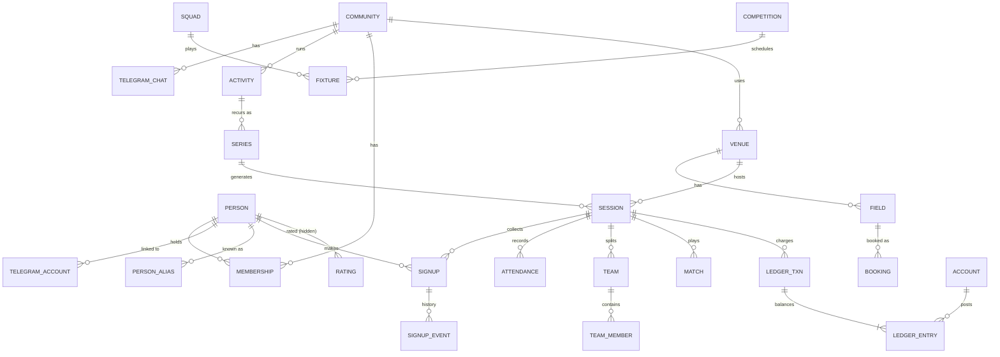

# Data model

Rondo's relational model, derived from 3.5 years of real community history (see
[community analysis](../research/community-analysis.md)) and the [epics](../epics/README.md).
PostgreSQL 18 is the single source of truth. The schema is code: `packages/db/src/schema/*.schema.ts` (Drizzle), migrations in `packages/db/drizzle/`.

## Design principles

| Principle                                  | How                                                                                                                                                                                                                                                            |
| ------------------------------------------ | -------------------------------------------------------------------------------------------------------------------------------------------------------------------------------------------------------------------------------------------------------------- |
| **Bounded contexts** | One Postgres schema per context (`identity`, `org`, `venue`, `scheduling`, `play`, `finance`, `league`, `comms`, `ingest`, `audit`), plus `play_private` for admin-only data and `analytics` for read models. Cross-context references are FKs by id only; no cross-context writes outside the owning service. |
| **Multi-tenant ready**                     | `community_id` sits on every aggregate root (child rows reach it through their parent). Row-level security is added together with the second tenant (no epic yet); there is one community today, so none is enabled yet.                                                                                                      |
| **Time-ordered ids** | `uuid` v7 primary keys generated in the app (`uuid` v7), so ids are sortable, index-friendly and safe to expose; switch to `uuidv7()` defaults on PG 18. Telegram ids are stored as `bigint` natural keys alongside. |
| **Time is explicit**                       | All instants are `timestamptz`; local wall-clock (Europe/Vienna) lives on the community. Intervals use `tstzrange` / `daterange` with **exclusion constraints** (no double-booking a field; no overlapping price rules).                                       |
| **History is append-only**                 | State tables have a matching `*_event` table (signup transitions, session changes, rating updates). Facts are never overwritten: reliability, audit and analytics read the events.                                                                             |
| **Money is double-entry**                  | `finance.ledger_entry` rows per transaction sum to zero (deferred constraint trigger). Integer cents, the currency lives on the `account`. No floats.                                                                                                                                 |
| **Enums as types, vocabularies as tables** | Small closed sets are Postgres enums (`signup_status`). Community-extensible sets are tables (activities, team colours).                                                                                                                          |
| **Privacy by design** | Personal data is concentrated in `identity`; analytics use `person_id`. `erasePerson` scrubs names, nicknames and raw tokens and sets `person.anonymized_at` without breaking aggregates (see the import runbook). Ratings live in `play_private`, granted only to the `rondo_admin` role. Row-level tenant isolation is planned with the second tenant (no epic yet). |
| **Provenance**                             | Every imported or derived row has `source` (`bot`, `import`, `manual`) and optional `ingest.source_ref_id`, so imported history can be re-run idempotently and told apart.                                                                                     |
| **Messages outside transactions** | A Telegram message is claimed in the database, sent, and its receipt stored. An unknown result is never sent again by itself. Polls and the end of a poll are the exception: they run inside a short transaction. There is no outbox worker. |

## Entity–relationship overview

## Schemas and tables

### `identity`: who people are (the PII boundary)

| Table              | Key columns                                                                                                                                                                                                                                                                           | Notes                                                                                                                                     |
| ------------------ | ------------------------------------------------------------------------------------------------------------------------------------------------------------------------------------------------------------------------------------------------------------------------------------- | ----------------------------------------------------------------------------------------------------------------------------------------- |
| `person`           | `id`, `display_name`, `locale` (`uk`/`ru`/…), `birth_date?` (opt-in), `created_at`, `anonymized_at?`                                                                                                                                                                                  | One human. Not tenant-scoped (a person can be in several communities).                                                                    |
| `telegram_author` | `id`, `community_id`, `display_name`, `tg_user_id?`, `person_id?`, `message_count`, `first_seen_at`, `last_seen_at` | Authors seen in imported history (HTML exports carry display names, not ids); linked to a person during alias resolution. |
| `telegram_account` | `tg_user_id bigint PK`, `person_id`, `username?`, `first_name`, `last_name?`, `language_code?`, `first_seen_at`, `last_seen_at`                                                                                                                                                       | Any number per person. Guests have none. Username is unique and current.                                                                                                        |
| `person_alias`     | `id`, `community_id`, `person_id?`, `guest_person_id?`, `alias`, `alias_norm` (lower, unaccented, transliterated), `kind` (`nickname`/`first_name`/`full_name`/`placeholder`/`self`), `occurrences`, `first_seen_at`, `last_seen_at`, `resolution` (`unresolved`/`suggested`/`confirmed`/`guest`/`ignored`/`vote`) | How players appear in line-ups (for example "Player 2", "Ivan Sample"). Unique `(community_id, alias_norm)`; re-imports keep confirmed links and refresh the rest; `occurrences` is counted from entries. `placeholder` marks a nickname shared by several players; it has no person. See ADR-0003. |
| `alias_link` | `id`, `community_id`, `alias_id`, `person_id`, `during daterange`, `method` (`admin`/`owner_list`), `status` (`approved`/`rejected`), `decided_by?`, `decided_at?` | Who a nickname is, for a range of game dates. No overlap per alias and person. See ADR-0003. |
| erased person (no table) | `person.anonymized_at`, `telegram_account.tg_user_id`, `person_alias.alias_norm` and `telegram_author.display_name` = `erased <hash>` | The stored decision: the Telegram ID stays on a nameless account, because votes refer to it and a hash of a number is guessed at once; nicknames and author names have no ID, so a hash salted with the community id lets an import recognise and mask them. It is pseudonymous: a guessed name can be confirmed with database access. |

### `org`: tenancy, groups and roles

| Table             | Key columns                                                                                                                                                                                  | Notes                                                             |
| ----------------- | -------------------------------------------------------------------------------------------------------------------------------------------------------------------------------------------- | ----------------------------------------------------------------- |
| `community`       | `id`, `slug`, `name`, `timezone` (default `Europe/Vienna`), `currency` (`EUR`), `default_locale` (`uk`, language of the group), `settings jsonb` (`ingest`, `poll`)                                                                    | Tenant root.                                                      |
| `telegram_chat`   | `chat_id bigint PK`, `community_id`, `kind` (`group`/`supergroup`/`channel`), `title`, `purpose` (`main`/`activity`/`squad`), `activity_id?`, `topic_id?` (games topic), `bot_rights jsonb`                             | Several chats per community (football, basketball, league squad). |
| `membership`      | `community_id`, `person_id`, `status` (`active`/`left`/`removed`), `joined_at`, `left_at?`, `invited_by_person_id?`, `sponsor_person_id?` (guests)                                           | PK `(community_id, person_id)`.                                   |
| `role_grant`      | `id`, `community_id`, `person_id`, `role` (`owner`/`organizer`/`helper`/`scorekeeper`/`manager`), `scope_type` (`community`/`activity`/`squad`/`session`), `scope_id?`, `valid tstzrange`    | Scoped RBAC; stand-ins get a time-boxed grant.                    |
| `activity`        | `id`, `community_id`, `sport` (`football`/`futsal`/`basketball`/`volleyball`/`beach_volleyball`/`table_tennis`/`boxing`/`other`), `name`, `defaults jsonb` (team size, formats, caps, price) | E14.                                                              |
| `player_profile`  | `person_id`, `activity_id`, `positions position[]` (`gk`/`def`/`mid`/`fwd`/`any`), `preferred_foot?`, `self_level smallint?`                                                                 | Self-declared; distinct from hidden rating.                       |

### `venue`: places, fields and bookings

| Table           | Key columns                                                                                                                                                                                                                                                   | Notes                                                                              |
| --------------- | ------------------------------------------------------------------------------------------------------------------------------------------------------------------------------------------------------------------------------------------------------------- | ---------------------------------------------------------------------------------- |
| `venue`         | `id`, `community_id`, `name`, `short_name?`, `station?` (both shown in polls), `address`, `district`, `lat`, `lng` (double, CHECK-bounded; PostGIS can be added later without API change), `transit text`, `indoor bool`, `parking`, `rules text`, `cancellation_policy jsonb` (`{free_until_hours:24, fee_cents:…}`), `hard_end_local time?`, `status` | Kendlerstraße, Donaucity, UniCredit Kaiserwasser, school gym, league grounds.      |
| `venue_alias`   | `venue_id`, `alias_norm`                                                                                                                                                                                                                                      | "U3", "Kendler", "Kendelstrasse", "Danube", "Unicredit".                           |
| `field`         | `id`, `venue_id`, `label` ("7", "big", "18"), `surface` (`artificial_turf`/`grass`/`parquet`/`sand`/`hall_turf`), `format_max` (a-side), `dimensions_m int4range?`, `indoor`, `lit`                                                                           | Numbered pitches.                                                                  |
| `booking`       | `id`, `field_id`, `during tstzrange`, `status` (`held`/`confirmed`/`released`), `cost_cents`, `cancel_deadline`, `booked_by_person_id`, `external_ref?`                                                                                                       | `EXCLUDE USING gist (field_id WITH =, during WITH &&) WHERE status <> 'released'`. |

### `scheduling`: sessions (games) and who's coming

| Table              | Key columns                                                                                                                                                                                                                                                                                                                                                                                                                                                  | Notes                                                                                  |
| ------------------ | ------------------------------------------------------------------------------------------------------------------------------------------------------------------------------------------------------------------------------------------------------------------------------------------------------------------------------------------------------------------------------------------------------------------------------------------------------------ | -------------------------------------------------------------------------------------- |
| `series`           | `id`, `activity_id`, `venue_id`, `rrule` (RFC 5545), `local_start time`, `duration`, `capacity_min/max`, `gk_slots`, `publish_offset interval`, `cancel_cutoff_offset`, `active daterange`                                                                                                                                                                                                                                                  | "Monday 19:00 Kendler, 18, €10".                                                       |
| `session`          | `id`, `community_id`, `activity_id`, `series_id?`, `venue_id`, `local_date`, `starts_at`, `ends_at?`, `status` (`draft`/`open`/`full`/`locked`/`played`/`cancelled`/`moved`), `capacity_min`, `capacity_max`, `gk_slots`, `fields_planned`, `format` (e.g. `3x6`), `signup_opens_at`, `cancel_cutoff_at`, `cancel_reason?` (`weather`/`low_turnout`/`venue`/`holiday`/`organizer`/`other`), `moved_to_session_id?`, `kind` (`casual`/`training`/`tournament`/`event`), `source` | The core entity. Imported sessions carry `confidence`.                                 |
| `session_change`   | `id`, `session_id`, `at`, `actor_person_id`, `diff jsonb`, `notified bool`                                                                                                                                                                                                                                                                                                                                                                                   | Time, venue, cap and status changes; drives E06 notifications.                         |
| `signup`           | `id`, `session_id`, `person_id`, `role` (`field`/`gk`), `status` (`in`/`maybe`/`out`/`waitlisted`/`offered`), `guest_of_person_id?`, `is_guest`, `priority` (`normal`/`held`/`reserve_bonus`), `created_at`, `updated_at`                                                                                                                                                                                                                              | Unique `(session_id, person_id)`. A guest (`is_guest`) is a one-game person without Telegram, with a host or none, counted in the limit. |
| `signup_event`     | `id`, `signup_id`, `at`, `from_status`, `to_status`, `actor_person_id`, `late bool`                                                                                                                                                                                                                                                                                                                                                                          | Append-only; late-cancel and reliability are computed from here.                       |
| `attendance`       | `session_id`, `person_id`, `outcome` (`attended`/`no_show`/`late`/`left_early`/`excused`), `late_minutes?`, `recorded_by`                                                                                                                                                                                                                                                                                                                                    | Post-game truth. Imported line-ups produce `attended`.                                 |

### `play`: teams, matches and ratings

| Table                                    | Key columns                                                                                                                                               | Notes                                                |
| ---------------------------------------- | --------------------------------------------------------------------------------------------------------------------------------------------------------- | ---------------------------------------------------- |
| `team_color`                             | `id`, `community_id`, `name`, `emoji`, `hex`                                                                                                              | Bib sets. Shown as the plain badges 🔴 🔵 🟢 🟡 ⚪ 🟠; the organizer's 💷 💶 💵 💴 💸 map to the same colours (`badges.ts`, data). |
| `team`                                   | `id`, `session_id`, `color_id`, `label?`, `predicted_strength numeric?`, `published_at?`, `rank?`                                                         | 2–6 per session. `rank` is the one-tap result of the evening (1 = won, equal ranks = draw). |
| `team_member`                            | `team_id`, `person_id`, `is_gk`, `is_captain`, `assigned_by` (`organizer`/`balancer`/`captain_pick`/`import`)                                             |                                                      |
| `lineup_entry` | `id`, `session_id`, `message_id`, `team_ordinal` (0 = guest from chat), `position`, `raw?`, `alias_id?`, `tg_user_id?`, `person_id?`, `guest_of_person_id?`, `resolved_by`, `is_gk`, `is_newcomer`, `is_guest`, `is_team_undecided` | Every line-up token verbatim and how it was resolved. A player without a person is unidentified. `team_member` and `attendance` are derived from it. |
| `match`                                  | `id`, `session_id`, `field_id?`, `seq`, `team_a_id`, `team_b_id`, `score_a`, `score_b`, `started_at?`, `ended_at?`, `stage` (`rotation`/`group`/`final`…) | Mini-games.                                          |
| `rating` _(schema `play_private`)_       | `person_id`, `activity_id`, `model` (`openskill_pl`/`organizer_seed`), `mu`, `sigma`, `games`, `updated_at`                                               | Hidden; only the organizer/admin role can read it. `organizer_seed` holds the tier set by tapping (new 3, normal 5, strong 8); `openskill_pl` is learned from results. |
| `home_colour` _(schema `play_private`)_ | `person_id`, `activity_id`, `colour`, `updated_at` | Hidden like the rating: the colour an admin fixed for a player; no row means automatic. |
| `rating_event` _(schema `play_private`)_ | `person_id`, `activity_id`, `match_id?`, `session_id?`, `mu_before/after`, `sigma_before/after`, `at`                                                     | Explainability and back-testing.                     |
| `lineup_delivery`                        | `session_id`, `chat_id`, `topic_id?`, `message_id?`, `text?`, `status` (`claimed`/`sent`/`uncertain`/`refused`), `token` | One claim and receipt per destination of a line-up; the random token is rotated on every claim and binds a retry button. |
| `team_draft`                             | `session_id`, `community_id`, `version`, `state jsonb` (teams, colours, locks, keepers, pending, three proposals, undo history), `proposed_at?`, `changed_at?`, `notified_at?`, `published_at?`, `publish_token?`, `publish_at?` | One shared draft per game; every change checks `version`; `publish_token` lets one publish of the game run at a time (taken over after a minute). See `team-balancing.md`. |

### `finance`: double-entry ledger (track only)

| Table              | Key columns                                                                                                                                                                                                                                 | Notes                                                                                                        |
| ------------------ | ------------------------------------------------------------------------------------------------------------------------------------------------------------------------------------------------------------------------------------------- | ------------------------------------------------------------------------------------------------------------ |
| `account`          | `id`, `community_id`, `kind` (`player_receivable`/`cash_box`/`organizer_bank`/`venue_payable`/`income`/`expense`/`prize_fund`), `person_id?`, `name`                                                                                        | One receivable account per player per community.                                                             |
| `price_rule`       | `id`, `community_id`, `scope` (`community`/`activity`/`series`/`venue`/`session`), `scope_id`, `applies_to` (`field`/`gk`/`guest`/`hall_of_fame`), `amount_cents`, `headcount int4range?`, `valid daterange`                                            | €7 → €8 → €10; GK €5; "€15 if ≤10 players". Exclusion constraint on overlapping validity per scope and role. |
| `ledger_txn`       | `id`, `community_id`, `occurred_at`, `kind` (`session_fee`/`late_cancel_fee`/`no_show_fee`/`payment`/`venue_cost`/`event_split`/`prize`/`adjustment`), `session_id?`, `event_id?`, `memo`, `created_by`, `approved_by?`, `reverses_txn_id?` | Immutable; corrections reverse.                                                                              |
| `ledger_entry`     | `id`, `txn_id`, `account_id`, `amount_cents bigint`                                                                                                                                                                             | Σ per txn = 0.                                                                                               |

### `league`: competitive squads

| Table                  | Key columns                                                                                                                                                                                                          |
| ---------------------- | -------------------------------------------------------------------------------------------------------------------------------------------------------------------------------------------------------------------- |
| `competition`          | `id`, `community_id`, `organizer` ("ÖKFB"), `name`, `season` ("2025/26"), `kind` (`league`/`cup`/`tournament`), `level` ("2. Liga", "35+")                                                                           |
| `squad`                | `id`, `community_id`, `activity_id`, `name` ("First team", "Second team", "Veterans 35+")                                                                                                                                           |
| `opponent`             | `id`, `community_id`, `name`, `aliases text[]`                                                                                                                                                                       |
| `fixture`              | `id`, `competition_id`, `squad_id`, `opponent_id`, `venue_id?`, `kickoff_at`, `home bool`, `stage?`, `goals_for?`, `goals_against?`, `penalties_for/against?`, `status` (`scheduled`/`played`/`postponed`/`forfeit`) |

### `comms`: Telegram I/O

`message_ref(chat_id, message_id, purpose (game_card/lineup/announcement), entity_type, entity_id)`: which Telegram message renders which entity (edited in place);
`imported_poll(poll_id, community_id, session_id?, chat_id?, message_id, posted_at, kind (participation/reserve/other), answers)`: every public poll of the history, once per poll id;
`poll_vote(poll_id, tg_user_id, session_id?, choice (yes/no/other), voted_at?)`: answers in imported polls and in the bot's polls (a retracted one is removed), signed up but not attended, `other` is unreadable; `session_id` only for participation polls; primary key `(poll_id, tg_user_id)`, forwards share one poll.

### `ingest`: imported history (data minimization)

`run(id, community_id, source (telegram_html/telegram_json), file_sha256, started_at, finished_at, stats jsonb)`,
`source_ref(id, run_id, chat_id, message_id, sent_at, kind (poll/lineup/cancel/result/price/service/message))`, storing references and extracted facts, **never raw message text**,
`extraction(id, source_ref_id, entity_type, entity_id, confidence, parser_version)`.

### `audit`

`audit.log(id, at, actor_person_id?, actor_kind (user/bot/system), community_id, action, entity_type, entity_id, diff jsonb)`, append-only (updates and deletes are rejected by trigger). Writers, triggers on mutable tables and monthly partitioning are planned.

## Tables that come with their feature

A table is added in the change that first reads or writes it. Migration `drop_unused_tables` removed 30 tables that no code used (consent, feedback, events, duties, payments and so on); it refuses to run when any of them has a row. Neither the release before it nor any earlier code reads or writes them, except that `merge_person` cleaned `notification_pref`; the migration replaces that function in the same transaction, so the previous deployment keeps working. Some kept tables have no writer in the app yet: `series` and `match` are referenced by columns of used tables (`session.series_id`, `rating_event.match_id`), and the ledger (`account`, `ledger_txn`, `ledger_entry`) and `field` / `booking` are covered by invariant tests.

## Read models and analytics

Materialized views refreshed with `select analytics.refresh_all()`, never written to by the app:

- `analytics.player_attendance`: games, first and last game per person and year (attended, late and left-early outcomes of played sessions).
- `analytics.venue_usage`: played and cancelled sessions per venue, weekday and year.
- `analytics.community_monthly`: sessions played and cancelled, attendances and active players per month.

Planned for later epics: per-season reliability and streaks, session fill and waitlist conversion, community health and balance quality.

## Key invariants (enforced in the database)

1. No overlapping confirmed bookings per field (`EXCLUDE … tstzrange &&`).
2. One signup per person per session.
3. Ledger transactions balance to zero, stay inside one community and use one currency (deferred constraint trigger).
4. Price rules don't overlap for the same scope, role and validity (`EXCLUDE … daterange &&`), checked separately among rules with a headcount range (where the ranges must not intersect) and among rules without one; an empty headcount range is rejected.
5. A team member belongs to at most one team per session (unique on `(session_id, person_id)` via a denormalized column).
6. `session.moved_to_session_id` implies `status = 'moved'` (CHECK).
7. Venue names are unique per community (the importer upserts venues by name).

## Roles and security

| Role | Can do |
|---|---|
| owner (migrations, importer) | Everything. Used only by migrations and the importer. |
| `rondo_app` | CRUD on context schemas; insert-only on `audit`; read on `analytics`. Default privileges cover tables created by later migrations. Tenant isolation through RLS is planned with the second tenant (no epic yet). |
| `rondo_admin` | `rondo_app` plus `play_private` (ratings), also through default privileges. |

Append-only tables (`finance.ledger_entry`, `scheduling.signup_event`, `audit.log`) reject UPDATE and DELETE by trigger.

## What the history filled on day one (E15)

First import of the community's export (June 2023 → November 2026), run with [`@rondo/ingest-telegram`](../runbooks/import-telegram-history.md) in about 4 seconds:

| Entity | Rows | Notes |
|---|---|---|
| `scheduling.session` | 413 | 389 played, 24 cancelled (with reason); football 385, plus futsal, beach volleyball, boxing and basketball |
| `play.team` / `play.team_member` | 660 / 4,173 | from ~205 posted line-ups |
| `scheduling.attendance` | 4,173 | `source = 'import'` |
| `identity.person_alias` | ~400 | about 120 recurring (≥ 5 games); typos and duplicates left for alias resolution |
| `identity.telegram_author` | 213 | |
| `venue.venue` | 7 | 5 with sessions; 99 sessions without a recognisable venue |
| `finance.price_rule` | 10 | €7 → €10 → €8 → €10 community-wide; venue-specific prices (school hall €5, GK €5 from Feb 2026) |
| `league.fixture` | 21 | 3 squads (main, second team, 35+), 2025/26 league levels |

Analytics (`analytics.player_attendance`, `venue_usage`, `community_monthly`) are refreshed with `select analytics.refresh_all()`.
